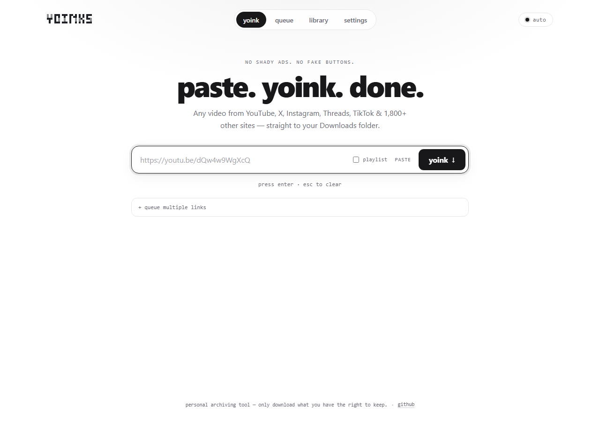
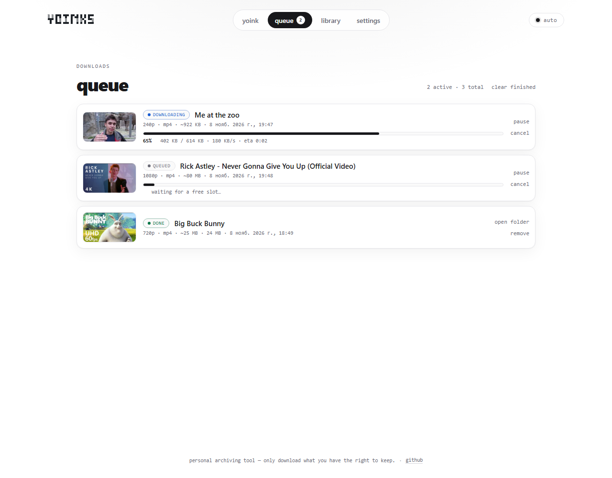
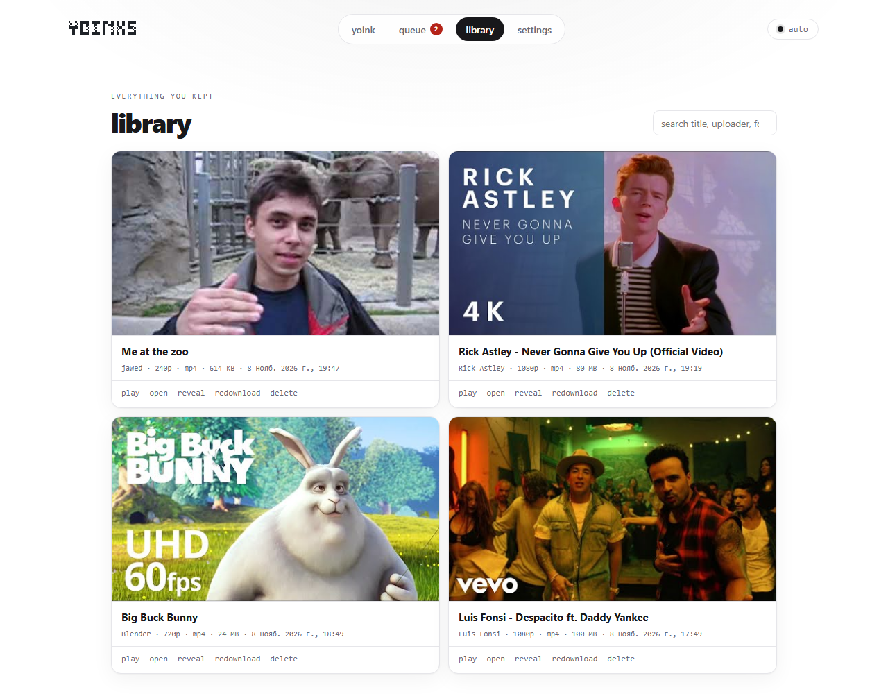
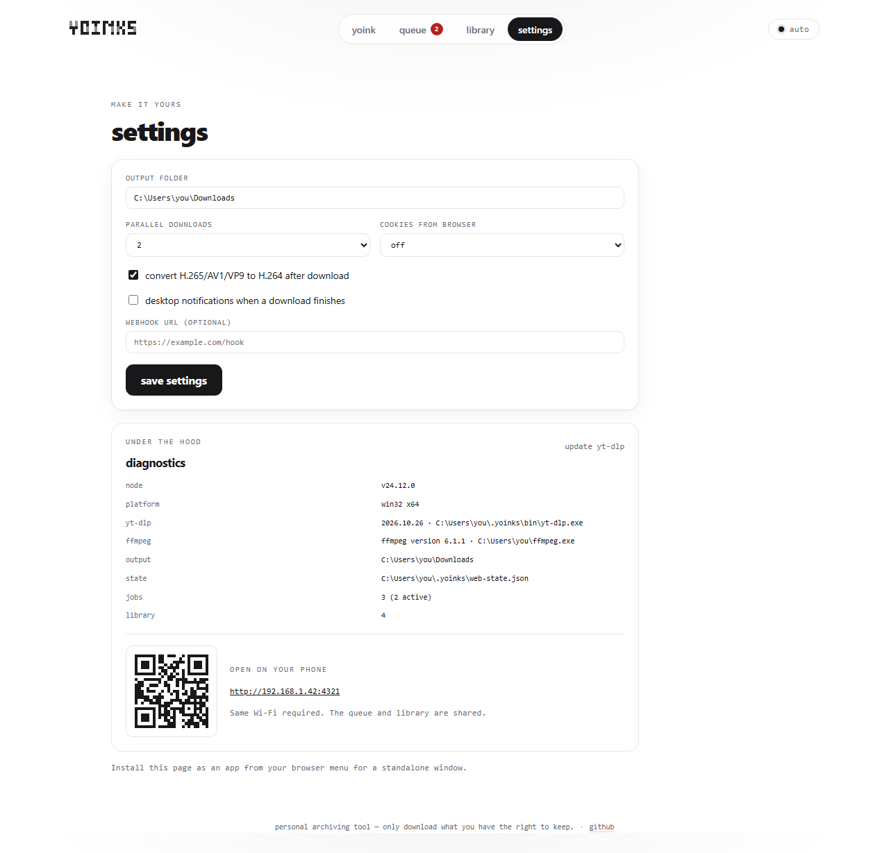
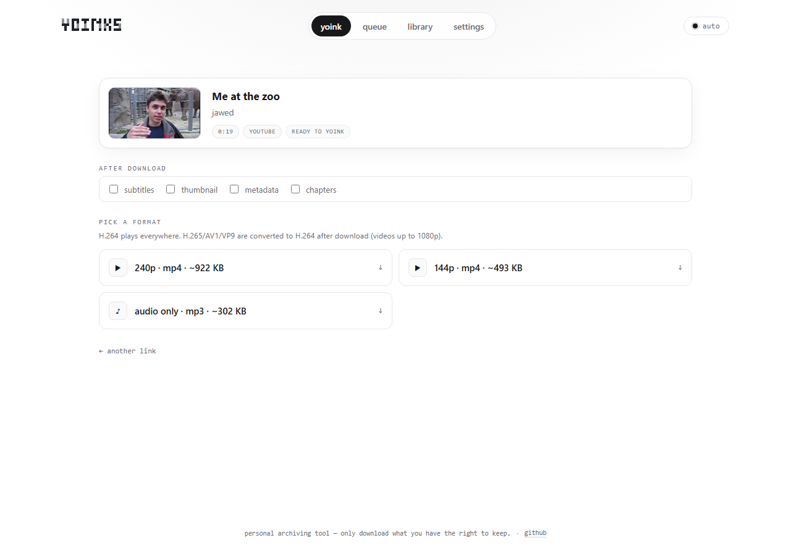

# yoinks + web UI (unofficial fork)

> **Unofficial fork of [pablostanley/yoinks](https://github.com/pablostanley/yoinks).**
> Not affiliated with or endorsed by the original author.
> The terminal CLI is the original project; this fork adds a local web UI.
>
> Fork maintained by [vanombus](https://github.com/IvanBurenin).
>
> **Website:** https://ivanburenin.github.io/yoinks-web-mod/
>
> See [FORK.md](FORK.md) for the fork checklist, upstream sync commands and issue-routing notes.

<picture>
  <source media="(prefers-color-scheme: dark)" srcset="assets/logo-dark.svg">
  
</picture>

yoink any video. paste. yoink. done.

Download videos from YouTube, X/Twitter, Instagram, Threads, TikTok and
1,800+ other sites — from your terminal or a local web UI. Paste a url, pick
a resolution (or audio-only mp3), done. No popups, no fake download buttons,
no sketchy redirects.

## What's different in this fork

The original terminal app is still included. This fork adds:

- a local web UI with a persistent **queue** (1–5 parallel downloads, pause / resume / cancel / retry)
- a **library** with thumbnails, search, in-browser preview, open file/folder, re-download and delete
- **playlist** entry selection and **batch link** queueing
- download options: subtitles, thumbnail, metadata, chapters
- settings for output folder, concurrency, cookies from a browser, H.264 conversion and webhooks
- diagnostics with one-click yt-dlp update, LAN URL + QR code
- PWA install, share target and desktop notifications

See [Web interface](#web-interface) below.

## Screenshots

<table>
  <tr>
    <td width="50%" align="center"><br><sub><b>yoink</b></sub></td>
    <td width="50%" align="center"><br><sub><b>queue</b></sub></td>
  </tr>
  <tr>
    <td width="50%" align="center"><br><sub><b>library</b></sub></td>
    <td width="50%" align="center"><br><sub><b>settings</b></sub></td>
  </tr>
</table>



## Quick start

### Locally

```sh
git clone https://github.com/IvanBurenin/yoinks-web-mod.git
cd yoinks-web-mod
npm run quick
```

`npm run quick` installs dependencies on the first run, starts the web UI and
opens **http://127.0.0.1:4321**. Use `npm run quick -- --no-open` to keep the
browser closed.

On Windows you can also double-click **`start-yoinks.cmd`** — it installs
dependencies, starts the server and opens the browser. If you make a desktop
shortcut, use `assets/yoinks.ico` as its icon.

Requires Node 18+.

### GitHub Codespaces

[](https://codespaces.new/IvanBurenin/yoinks-web-mod)

Creates a cloud dev environment, installs dependencies and forwards port 4321.
Run `npm run web` in the terminal to start the UI.

## Install

This fork is **not published to npm**. `npm install -g yoinks` and `npx yoinks`
install the upstream package, not this fork.

```sh
git clone https://github.com/IvanBurenin/yoinks-web-mod.git
cd yoinks-web-mod
npm install
npm run build

# optional: expose the local binaries
npm link
yoinks https://youtu.be/dQw4w9WgXcQ    # original terminal UI
yoinks-web                             # web UI on http://127.0.0.1:4321
```

Requires Node 18+. Everything else (yt-dlp, ffmpeg) is fetched or bundled
automatically.

> If you also have the upstream package installed globally, `npm link` shadows
> its `yoinks` command. Use `yoinks-web` for the web UI, or remove one of the
> global links.

## Usage

```sh
$ yoinks https://youtu.be/dQw4w9WgXcQ    # straight to the format picker
$ yoinks                                 # prompts for a url
$ yoinks --theme light                   # force the light palette
```

yoinks takes over the terminal (full-screen, centered — and restores your
scrollback on exit). Pick a format with ↑/↓ (or j/k, or number keys) and
hit enter. `esc` goes back, `^c` quits. Or just use the mouse — the yoink
button, the format list and the footer hints are all clickable, and
clicking the logo takes you back home. Files are saved to `~/Downloads`,
and the file path is printed to your terminal when you're done.

The default `auto` theme uses your terminal's own foreground and background,
so it follows light and dark terminal themes without guessing. Press `^t` or
click the theme control in the footer to cycle through `auto`, `light`, and
`dark` for the current session. Use `--theme auto`, `--theme light`, or
`--theme dark` to choose the starting theme for one launch.

## Web interface

The repo also includes a local web UI — same yt-dlp engine and format picker, but in your browser.

### Quick start (Windows)

Double-click **`start-yoinks.cmd`** in the repo root. It checks for Node.js,
runs `npm install` on the very first launch, starts the server and opens
`http://127.0.0.1:4321` in your browser. If the server is already running, it
just opens the page. Close the console window (or press `Ctrl+C`) to stop it.

Arguments are passed through, e.g. `start-yoinks.cmd --port 5000 --host 0.0.0.0`.

`assets/yoinks.ico` is used as the shortcut icon, so you can also right-click
`start-yoinks.cmd` → *Send to* → *Desktop (create shortcut)*.

### Manual start

```
npm run web            # http://127.0.0.1:4321
npm run web:dev        # same, restarts on server changes
npm run build && npm run web:start
```

After `npm link` the packaged build is also available as `yoinks-web`.

Options:

- `--port <n>` — default `4321`
- `--host <host>` — default `127.0.0.1` (use `0.0.0.0` to expose it on your LAN)
- `--out <dir>` — default `~/Downloads`
- `--concurrency <n>` — default `2` (also editable in settings)
- `--open` — open the browser after the server starts

What the web version adds over the terminal:

- **Queue** — multiple links, 1–5 parallel downloads, pause / resume / cancel / retry, and the queue survives a server restart.
- **Batch links** — paste one link per line and queue them all; each entry is probed and gets the best compatible format automatically.
- **Playlists** — tick the playlist box (or paste a playlist/channel URL) to load the flat entry list, select entries and queue them.
- **Library** — every finished download with thumbnail, title, uploader, format, size and date. Search, play a preview in the browser, open the file/folder, re-download, or delete it (optionally from disk).
- **Per-download options** — embed subtitles, save the thumbnail, embed metadata and chapters.
- **Settings** — output folder, concurrency, cookies from a browser (`chrome`, `edge`, `firefox`, …), automatic H.264 conversion, and a webhook URL that receives a JSON POST when a job finishes or fails.
- **Diagnostics** — yt-dlp/ffmpeg/Node versions, state file location, one-click yt-dlp update, and a LAN URL with a QR code for opening the UI on your phone.
- **PWA** — manifest + service worker, so the page can be installed as an app; optional desktop notifications when a download finishes.

State lives in `~/.yoinks/web-state.json`; finished files live in the configured output folder. The server reuses the exact `probe` / `buildChoices` / `download` functions from `src/lib/ytdlp.ts`, so the CLI and the web UI stay in sync.

> **LAN note:** the server has no authentication. Keep the default `127.0.0.1` binding unless you trust everyone on the network, and never expose it directly to the internet. `--host 0.0.0.0` is intended for a phone on the same Wi-Fi. PWA installation and desktop notifications need a secure context (localhost or HTTPS); on a plain `http://LAN-IP` the UI works, but the browser will not offer installation.

## How it works

- Powered by [yt-dlp](https://github.com/yt-dlp/yt-dlp). On first run,
  yoinks downloads the standalone yt-dlp binary to `~/.yoinks/bin` —
  no Python required. If you already have yt-dlp installed, it uses yours
  unless it is more than 45 days old; then the latest standalone binary is
  fetched into `~/.yoinks/bin` and used instead. Stale extractors are the
  usual cause of sudden `HTTP Error 403` failures.
- Video choices prefer H.264 + AAC in an mp4 container, so the file opens in
  Windows Media Player, QuickTime, and on phones. Formats that only exist as
  H.265/AV1/VP9 (often 1440p and up on YouTube, or the only stream on some
  TikToks) are labelled with the codec. In the web UI those choices are
  automatically re-encoded to H.264/AAC after download when the video is
  1080p or smaller and under 15 minutes.
- ffmpeg (needed for merging high-res streams and mp3 extraction) is found
  on your PATH, with `ffmpeg-static` as a bundled fallback.
- The terminal UI is [Ink](https://github.com/vadimdemedes/ink) — React for the
  terminal. The web UI is plain HTML/CSS/JS with no build step, served by
  `src/server.ts`.

## Development

```sh
npm install
npm run build        # bundle to dist/ with tsup
npm run dev          # rebuild on change
node dist/cli.js <url>
npm run web          # web UI (tsx, no build step)
npm run typecheck
npm test
```

To try the CLI as a global command without publishing: `npm link`, then run
`yoinks` (or `yoinks-web` for the web UI) anywhere.

## Reporting issues

- Web UI, queue, library, settings, PWA or API bugs — open an issue in **this fork**.
- Original terminal CLI or yt-dlp extraction bugs — report them to the [upstream project](https://github.com/pablostanley/yoinks/issues).

## Roadmap

Upstream roadmap (unchanged; checkboxes refer to the original project):

- [ ] `--best` / `--mp3` flags to skip the picker (scriptable mode)
- [ ] `-o <dir>` to choose the output folder
- [ ] Playlist / thread-with-multiple-videos support
- [ ] Clipboard detection: launch bare and auto-suggest the url you copied
- [ ] Self-update for the bundled yt-dlp binary (`yt-dlp -U`)
- [x] Publish to npm (`npm i -g yoinks` / `npx yoinks`)
- [ ] `curl yoinks.sh | sh` installer

## A note on fair use

yoinks is a personal-archiving tool. Downloading content may violate a
platform's terms of service — only download what you have the right to
keep, and be excellent to creators.

## License

See [LICENSE](LICENSE) for the full license text and copyright notices.

- Original code: Copyright (c) 2026 Pablo Stanley.
- Fork modifications: Copyright (c) 2026 vanombus.

The license covers the source code. The original name and logo are not
covered by a trademark grant; this fork is unofficial and is not affiliated
with or endorsed by the original author.
